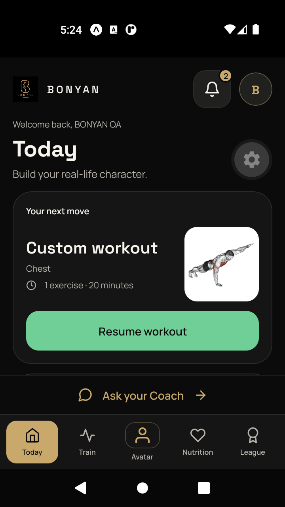
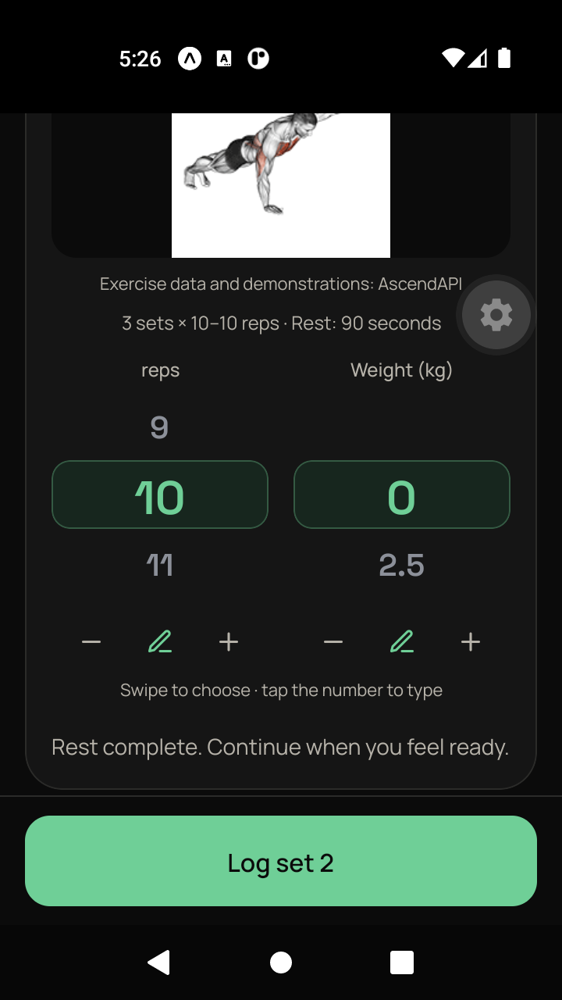
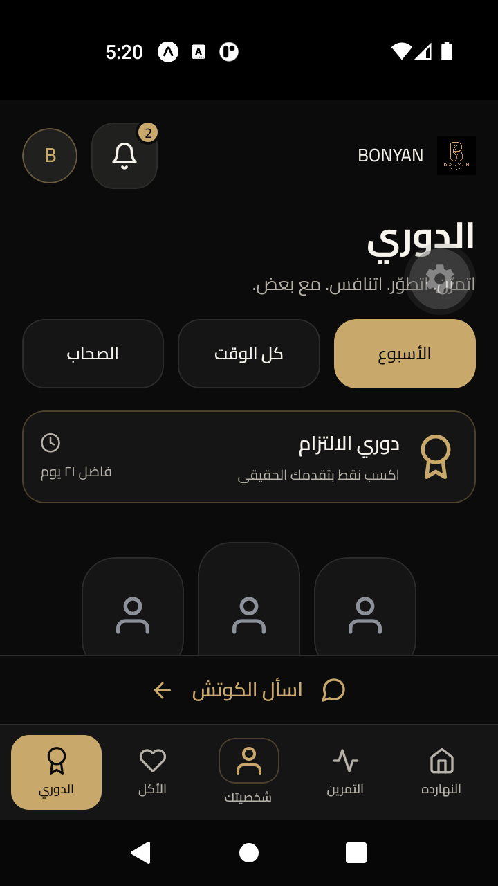

# BONYAN

**Personal training. Private progress. Consistent growth.**

BONYAN V2 is a fitness platform that connects guided workouts, body-composition
report review, an AI Coach, a personal Avatar and opt-in leagues. Built for
English and Egyptian Arabic, it supports persistent language preferences,
right-to-left layouts and a shared experience across Android, iOS and web.

[](https://github.com/tarekamr737/BONYAN/actions/workflows/ci.yml)
[](https://github.com/tarekamr737/BONYAN/actions/workflows/release-images.yml)

[Features](#features) · [Getting started](#getting-started) ·
[Quality checks](#quality-checks) · [Contributing](#contributing) ·
[Documentation](#documentation)

> **Current status:** V2 is merged into `main` as the team's shared development
> baseline. CI validates changes before merge, and the release workflow publishes
> staging API images. Production and store distribution have separate approval
> gates, documented in the [V2 handoff](docs/release/v2-development-baseline.md).

## Features

| Area | Experience |
| --- | --- |
| **Today** | The next workout, recorded progress and weekly missions in one place. |
| **Train** | Visual exercise discovery, manual and generated plans, movement demonstrations, swipe/exact set logging and session recovery. |
| **Avatar** | Private, measurement-informed illustrations with source provenance, revision history and explicit review. |
| **Nutrition** | Meal planning and logging connected to personal goals. |
| **League** | Opt-in competition based on earned Mission Points, with challenges, badges and a rewards wallet. |
| **AI Coach** | Contextual guidance in English or Egyptian Arabic; proposed workout changes require a preview and explicit approval. |

Progress Score tracks evidence of personal progress; XP and Mission Points track
earned activity. Missing evidence stays unknown. Avatar illustrations are
measurement-informed visuals, not clinical models. Legacy Community feed routes
now lead to League.

### Screen previews

<p>
  
  
  
</p>

Android QA previews use synthetic test accounts. See the
[QA report](docs/product/BONYAN_V2_QA.md) for validation scope and remaining gates.

## Architecture

BONYAN uses a modular monolith. The backend owns authentication, private files,
provider integrations and business rules; private endpoints are versioned under
`/api/v1`. Provider credentials stay on the backend.

| Layer | Technology |
| --- | --- |
| Mobile and web | Expo, React Native, TypeScript, Expo Router |
| Server state | TanStack Query |
| API | FastAPI, Pydantic v2 |
| Persistence | PostgreSQL 17, SQLAlchemy 2, Alembic |
| Integrations | Provider adapters for exercises, OCR, Coach and Avatar generation |
| Delivery | GitHub Actions, Docker, Expo/EAS build configuration |

```text
apps/
  mobile/       App screens, navigation and shared UI
  api/          Domain services, authenticated API and migrations
infra/          Local PostgreSQL configuration
deployment/     API container, environment templates and smoke checks
scripts/        Development and validation tooling
tests/          Backend, integration and release tests
docs/           Product contracts, architecture, QA and release guides
```

## Getting started

### Prerequisites

- Node.js 24 and npm 11.
- Python 3.12–3.14; CI uses Python 3.13.
- Docker with Compose for local PostgreSQL.
- Expo Go, an Android emulator or a web browser for development.

The commands below use PowerShell and assume a fresh checkout. On macOS/Linux,
use `cp` for file copies and `source .venv/bin/activate` to activate Python.

### 1. Install dependencies

```powershell
git clone https://github.com/tarekamr737/BONYAN.git
cd BONYAN
npm ci
python -m venv .venv
.\.venv\Scripts\Activate.ps1
python -m pip install -e "apps/api[dev]"
```

### 2. Configure local development

```powershell
Copy-Item apps/api/.env.example apps/api/.env
Copy-Item apps/mobile/.env.example apps/mobile/.env
```

In `apps/api/.env`, set a unique `AUTH_JWT_SECRET` of at least 32 bytes. Generate
one locally with:

```powershell
python -c "import secrets; print(secrets.token_urlsafe(48))"
```

The API template names live providers. For development without provider
credentials, replace these settings in `apps/api/.env`:

```dotenv
CHAT_PROVIDER=mock
CHAT_MODEL=TBD
AVATAR_PROVIDER=mock
AVATAR_MODEL=TBD
```

Mocks support development without paid Coach or Avatar calls. Real OCR requires
a backend `MISTRAL_API_KEY`. Configure live services using the
[provider guide](docs/providers/CONFIGURATION.md), respecting consent, cost and
the existing production provider/license gates.

### 3. Start PostgreSQL and apply migrations

```powershell
docker compose -f infra/compose.yaml up -d postgres
python -m alembic -c apps/api/alembic.ini upgrade head
```

The local Compose configuration exposes PostgreSQL on port `5432`, matching the
API template. Change `DATABASE_URL` if you use another local database.

### 4. Run the API and app

In a terminal with the Python virtual environment activated:

```powershell
python -m uvicorn app.main:app --reload --app-dir apps/api
```

In a second terminal, from the repository root:

```powershell
npm run mobile:dev
```

Expo provides device launch options and a QR code. Check the local API at
[`/health`](http://127.0.0.1:8000/health) and
[`/ready`](http://127.0.0.1:8000/ready); development API documentation is available
at [`/docs`](http://127.0.0.1:8000/docs).

### Device connectivity

Set `EXPO_PUBLIC_API_URL` in `apps/mobile/.env` and `API_PUBLIC_URL` in
`apps/api/.env` to an address reachable by the selected client. The backend URL
also controls generated media links.

| Client | Reachable API address |
| --- | --- |
| Browser on the development computer | `http://127.0.0.1:8000` |
| Android emulator on the same computer | `http://10.0.2.2:8000` |
| Physical phone on the same network | `http://<computer-LAN-IPv4>:8000` |

For a physical phone, start Uvicorn with `--host 0.0.0.0`, keep both devices on
the same trusted network and allow port `8000` on that network. Restart Expo
after changing its environment. Expo and an installable mobile build both need
a reachable backend; see the [device guide](docs/release/team-device-installation.md).

## Quality checks

Run from the repository root with the Python virtual environment activated:

```powershell
npm run mobile:lint
npm run mobile:routes
npm run mobile:typecheck
npm run mobile:test
python -m ruff check --config apps/api/pyproject.toml apps/api/app tests deployment
python -m pytest -c apps/api/pyproject.toml
```

CI additionally exports Android, iOS and web bundles, validates PostgreSQL
migrations and builds the API container. Database integration tests and live
provider suites have explicit environment requirements; skipped checks remain
separate from passing checks. See the [QA evidence](docs/product/BONYAN_V2_QA.md)
for the latest recorded results and the
[release checklist](docs/release/checklist.md) for distribution requirements.

## Privacy and security

- Keep `.env` files, tokens, private reports, body photos and generated Avatars
  outside Git. This repository is public.
- Put provider keys, signing secrets and database credentials on the backend.
  `EXPO_PUBLIC_*` values are bundled into the client.
- Review report values before confirmation. Failed OCR supports explicit manual
  review; ambiguous or unreported measurements remain unknown.
- Avatar review and sharing are separate choices. League participation does not
  automatically publish a member's name, Avatar or Progress Score.

## Contributing

Start each task on an independent feature branch from the latest `main`. With
a clean checkout:

```powershell
git fetch origin
git switch main
git pull --ff-only origin main
git switch -c feat/my-task
```

Coordinate ownership of shared routing, configuration, migrations and lockfiles.
Open focused PRs into `main`; protected checks require `mobile`, `api` and
`release-container` to pass. Follow [CONTRIBUTING.md](CONTRIBUTING.md) and the
[V2 team handoff](docs/release/v2-development-baseline.md) for parallel work.

## Documentation

| Guide | Purpose |
| --- | --- |
| [V2 product contract](docs/product/BONYAN_V2.md) | Product behavior and implementation decisions |
| [V2 task tracker](docs/product/BONYAN_V2_TASKS.md) | Completed slices and outstanding work |
| [V2 QA report](docs/product/BONYAN_V2_QA.md) | Test evidence, device coverage and release gates |
| [Core integration guide](docs/workstreams/01-core/INTEGRATION.md) | Architecture and domain registration |
| [Provider configuration](docs/providers/CONFIGURATION.md) | Backend integration setup |
| [Provider decisions](docs/providers/DECISIONS.md) | Provider selection and validation context |
| [Team device guide](docs/release/team-device-installation.md) | Local connectivity and signed test builds |
| [Deployment guide](docs/release/deployment.md) | API deployment and recovery procedures |
| [Release checklist](docs/release/checklist.md) | Staging and production verification |
